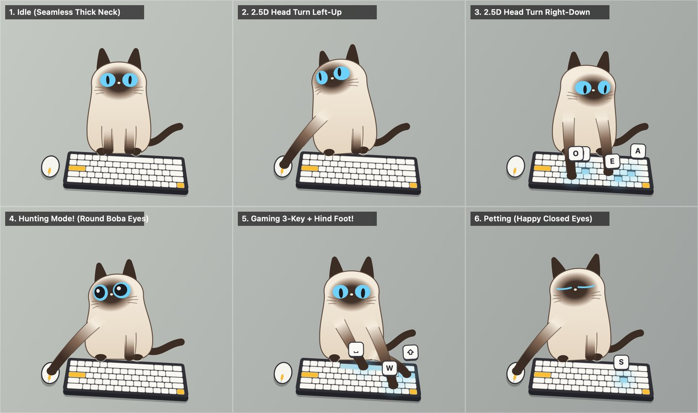
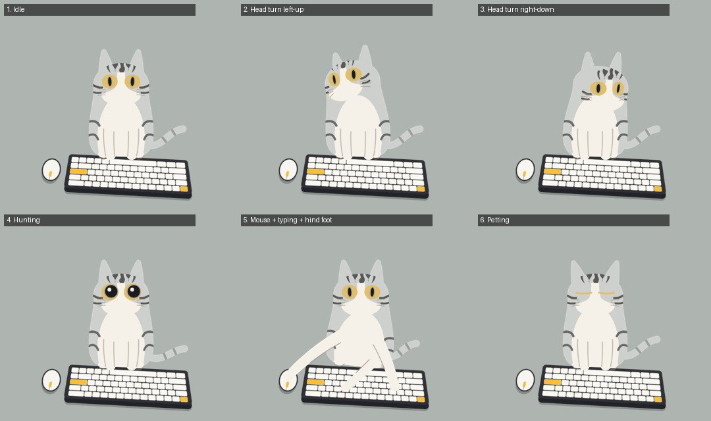

# 🐱 KuroCatWork

<p align="center">
  <b>A desktop cat that types with you — and keeps you company while your AI works.</b><br/>
  Companion + Codex / Claude Work Mode · Native macOS · Four Skins · 2.5D Head Tracking
</p>

<p align="center">
  <a href="README.md">简体中文</a> | <b>English</b> ·
  <a href="https://github.com/andyforfun168/KuroCatWork/releases/latest">⬇️ Download</a> ·
  <a href="https://github.com/andyforfun168/KuroCatWork/releases/download/v1.4.4/KuroCatWork-demo.mp4">🎬 Demo</a> ·
  <a href="https://github.com/chanke17/KuroCat">🐾 Original KuroCat</a> ·
  <a href="https://workshop.kurocat.cc/">🎨 Original Skin Workshop</a>
</p>

> **Relationship to the original:** KuroCatWork is based on [chanke17/KuroCat](https://github.com/chanke17/KuroCat), with the original copyright and MIT license preserved. [andyforfun168](https://github.com/andyforfun168) maintains this independent work-mode project. The earlier fork remains at [KuroCatLocal](https://github.com/andyforfun168/KuroCatLocal).

<p align="center">
  
  
</p>

*Demo quota and task values are simulated. Real values require connecting your tools.*

---

## 💡 Why KuroCatWork?

Your cat stays at the center of the experience. **Double-click** to switch between an ordinary typing companion and a small AI-work monitor. Read quotas and task states beneath its keyboard, or listen to its typing while you focus elsewhere.

| What you want to know | What the cat shows |
| --- | --- |
| Is anything running? | Keyboard lighting, two-handed typing and yellow task bubbles |
| Does a task need me? | The cat stops autonomous typing, looks up and shows a purple waiting bubble |
| How much allowance is left? | Blue Codex / orange Claude fill bars; hover for exact values and reset times |
| Has it finished? | Green result bubbles; failed or terminated tasks appear red |
| Can it stay a simple pet? | Ordinary mode stops AI monitoring; each work animation and sound is configurable |

---

## ✨ Features

- **⌨️ Two modes, one double-click**
  - Ordinary mode follows your typing and mouse. Work mode alone turns on the RGB keyboard lighting.
  - A native space-key bubble rises, becomes a dimensional bar and settles below the keyboard. Bars stay parallel to the keyboard and scale with the cat.
  - Switch manually whenever you like. With no running or awaiting tasks for **30 minutes**, the cat returns to ordinary mode. It stays awake in work mode and resumes normal idle-sleep behavior afterward.

- **🔵🟠 Codex + Claude at a glance**
  - Choose Codex, Claude, both, or automatic detection. Opening another supported tool can add its quota bar through the space-key animation.
  - Fill shows remaining allowance; the small secondary strip shows the weekly allowance, and the outer seven-day track shows time until the weekly reset. Hover for details.
  - Only allowance windows actually returned by the service are shown. Missing windows are not invented or treated as zero; plan names do not determine which windows appear.
  - Quotas refresh about every **60 seconds**. On connection failure, previous values remain with a stale-status indication.

- **🫧 Tasks become bubbles the cat types into existence**
  - Tasks are checked about every **6 seconds**. Show up to **three** by default, with more available to expand. Waiting tasks come first, then running tasks and unread results.
  - **Yellow: running · Purple: awaiting you · Green: completed · Red: failed or terminated.** Titles, status and elapsed time are always visible; hover for project, source and timestamps. Detail cards choose a position that fits the screen.
  - **Open to handle / View result / View details** jumps to the corresponding chat. Approval remains in Codex or Claude; the cat does not approve actions on your behalf. Terminal tasks without a usable chat link show available source details instead.
  - Both manual and automatic exits fade out completed tasks. Re-entering retains unresolved awaiting and failed items, without repeatedly restoring the same dismissed completion.

- **🐾 A cat that thinks, works and occasionally gets grumpy**
  - When a task runs and none are awaiting you, the cat looks down and types with both paws. Your real keyboard and mouse input take priority.
  - It occasionally slows down for about **three seconds**, then smoothly returns to full speed. Random angry or spiral-eye expressions appear roughly once a minute; long tasks make dizziness more likely. Dizziness resolves through a quick double blink.
  - Awaiting tasks stop autonomous typing and make the cat look at you. After **five minutes**, it gets grumpy until you handle the request, while its paws still follow real input.
  - Autonomous typing, random expressions and keyboard bubbles have separate switches. Turning off ordinary keyboard bubbles preserves the special space bubbles needed to create quota and task bars. Turning off random expressions preserves waiting reminders and shake-triggered dizziness.

- **🔊 Three keyboard sounds, bubble pops and a meow**
  - Sound is off by default and only plays in work mode. Choose **Blue, Brown or Red** switch recordings, with independent keyboard and meow volumes.
  - Quota and task bars have distinct short pop sounds, with their own switch and volume. Switching off sound or leaving work mode stops playback.
  - **Hear the work:** with autonomous typing and sound enabled, the start and pause of typing help you notice task activity without watching the screen. Autonomous typing pauses when work finishes **or** awaits you; use the green or purple task bubble to confirm which. Real typing also makes sound, so silence alone is not a completion signal.

- **🤏 Pick up the cat — and its work**
  - Drag anywhere on the cat, with double-clicks distinguished from drags. The grip stays near its back; the body, paws and tail have gentle inertia.
  - Its right paw carries the mouse or tablet; its left carries the tilted keyboard. Work bars spring upward one after another beneath them, then follow with restrained sway. Buttons are temporarily inactive while dragging.
  - About **1.2 seconds of effective back-and-forth shaking** triggers spinning eyes without a mid-air collapse. Releasing the cat preserves its recovery period.

- **🎨 Shared skins and familiar pet interactions**
  - Four built-ins: Black, Siamese, Silver Tabby and Orange & White. The latter two retain white extended paws, natural shoulder joins, pink noses and mouths, and head-following facial details.
  - Re-selecting Orange & White applies Amber Gold eyes; Silver Tabby applies Gold & Teal. Eye colors remain freely adjustable afterward.
  - **Compatible skin ecosystem:** make or download a `.kurocat` skin from the original author's [Skin Workshop](https://workshop.kurocat.cc/), then import it through the dressing room. The shared original format works in ordinary and work modes, including typing, head tracking, dragging and work bars. Custom `.kurokb` keyboards are supported too.
  - Keep 2.5D head tracking, hunting eyes, head petting, tail dodges, third-paw and four-key tail interactions. All four cats share the rounded sleeping pose, with closed-eye lines following the selected eye color.

### 🎨 Four skins, six poses

| Black | Siamese |
| :---: | :---: |
|  |  |

| Silver Tabby | Orange & White |
| :---: | :---: |
|  |  |

---

## 📦 Download and get started

### 🍎 macOS 11+ · Apple Silicon + Intel Universal

1. Download **`KuroCatWork-macOS-universal.zip`** from [Releases](https://github.com/andyforfun168/KuroCatWork/releases/latest), unzip it and move `KuroCatWork.app` into Applications.
2. Quit the older cat before opening this one. Grant **System Settings → Privacy & Security → Input Monitoring** when prompted, then restart the cat from its menu. This release is not Apple-notarized; if macOS blocks first launch, review the opening option supplied by Privacy & Security.
3. **Double-click the cat** to enter work mode and choose your tools.
4. Connect tools through **Work Mode · Live Connection** in the context menu:
   - **Codex:** requires an existing Codex CLI installation. Use the menu's Codex sign-in action or `codex login`. Limits are read through `codex app-server`; local desktop / CLI sessions supply task activity.
   - **Claude:** connect and sign into the Claude web window. Optional local task hooks provide explicit permission/question states for supported terminal sessions; installation prompts you and preserves existing configuration.
5. Open **Settings → Work Mode** for typing, random expressions, bubbles, sound, switch type and volume. Size and direction use context-menu sliders.

**Work mode currently ships for macOS.** For Windows or Linux, visit [original KuroCat](https://github.com/chanke17/KuroCat). This repository does not offer unported work-mode builds for those systems.

### Practical notes

Tool data formats and service interfaces can change. If a task is missing, check the connection status, tool sign-in and optional task-hook connection. Missing data never becomes fake quota. Open-to-handle buttons navigate to the chat rather than granting approval.

The existing KuroCat bundle identifier and settings path are retained to help migration. **Do not run both cats at the same time.** Updates are downloaded manually from this repository's Releases.

## ⚙️ Settings

The context menu provides work-mode connections, skin choices, size/direction sliders and app controls. The grouped settings window includes:

| Group | Controls |
| --- | --- |
| Appearance | Skins / dressing room, keyboard import, eyes, outline, flip, rotation and size |
| Interaction | Angry typing, normal key/click bubbles, keycap legends and tablet display |
| Work Mode | Autonomous typing, random expressions, independent keyboard bubbles, sounds, switch type and three volume controls |
| Window & system | Fullscreen overlay, click-through, startup and language |

<p align="center"></p>

## 🔒 Privacy and connections

Keyboard/mouse input drives animation locally; it is not uploaded as task content. Work mode reads local session metadata and recent activity records, and uses your signed-in tool/service connections to request usage or task status. Task titles, unread states and settings are stored locally so they survive restarts. Optional hooks record task-state metadata, not tool inputs.

Ordinary mode stops AI polling. No automatic approval, background app updater or silent update replacement is included. Keep screenshots and task titles in mind when sharing your own recordings.

## 📁 Project structure

```text
KuroCatWork/
├── Sources/       # Native macOS app, pet drawing, work monitoring and audio
├── Resources/     # Icon, app metadata and bundled local sound samples
├── assets/        # README screenshots and skin previews
├── docs/          # Build and release notes
├── tests/         # Isolated local checks
├── build.sh       # Universal macOS build
├── LICENSE        # Original MIT license
└── THIRD_PARTY_NOTICES.md
```

Build with `bash build.sh` using Xcode Command Line Tools. See [development notes](docs/DEVELOPMENT.md); run `bash tests/run.sh` for isolated checks.

## 🙏 Credits and license

- [chanke17/KuroCat](https://github.com/chanke17/KuroCat): original pet, rendering, interactions and skin ecosystem.
- [andyforfun168](https://github.com/andyforfun168): work-mode experience, art adaptations and maintenance of this repository.
- Recording credits and licenses: [Third-party notices](THIRD_PARTY_NOTICES.md).

[MIT License](LICENSE), with the original copyright notice preserved.
