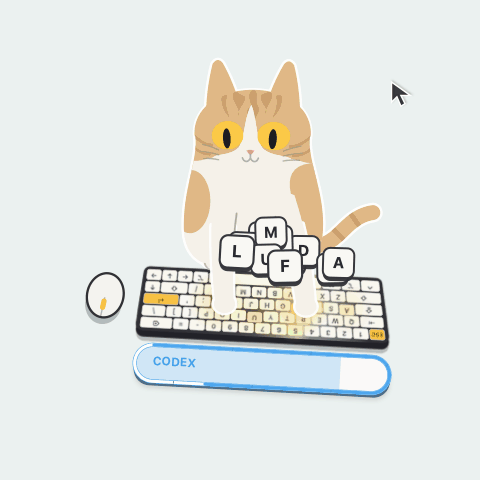
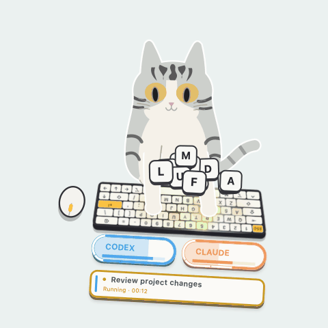
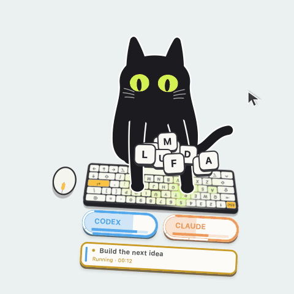
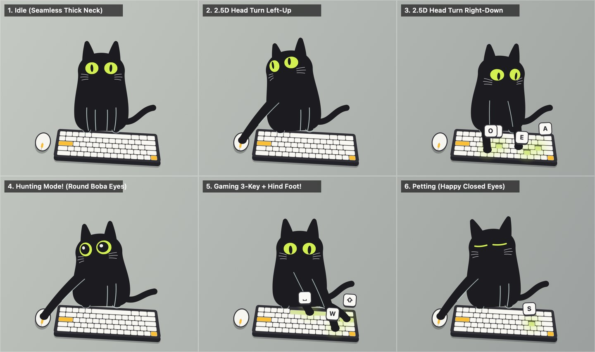
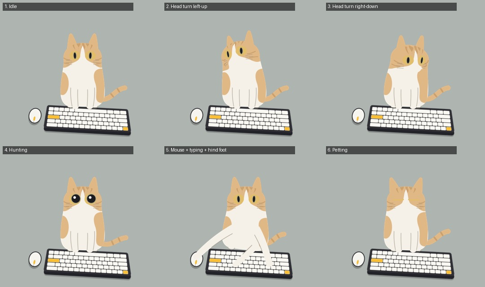
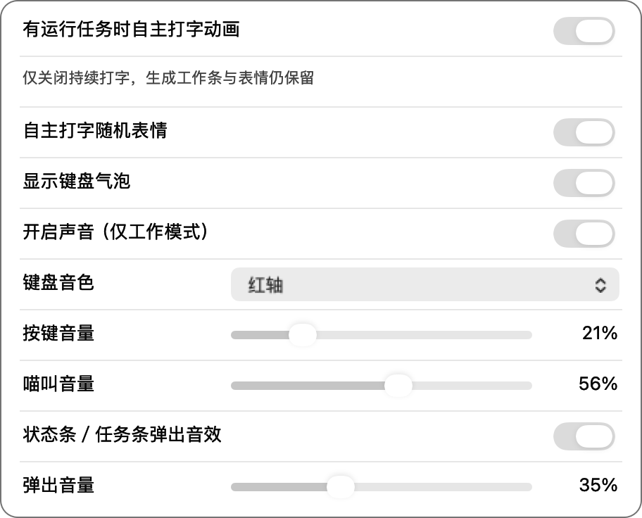

<h1 align="center">🐱 KuroCatWork</h1>

<p align="center">
  <b>A native desktop cat for typing, companionship and AI work.</b><br/>
  Companion & Work Modes · Codex / Claude · Task Bubbles · Shared Skins
</p>

<p align="center">
  <a href="https://github.com/andyforfun168/KuroCatWork/releases/latest"></a>
  
  <a href="LICENSE"></a>
</p>

<p align="center">
  <a href="README.md">简体中文</a> | <b>English</b> ·
  <a href="https://github.com/andyforfun168/KuroCatWork/releases/latest">⬇️ Download</a> ·
  <a href="https://github.com/andyforfun168/KuroCatWork/releases/download/v1.4.4/KuroCatWork-demo.mp4">🎬 Demo</a>
</p>

> Built on [KuroCat](https://github.com/chanke17/KuroCat), with a Codex / Claude work mode for your desktop cat.

<p align="center">
  
  
  
</p>

*Demo quota and task values are simulated. Real values require connecting your tools.*

---

## 💡 Why KuroCatWork?

Your cat stays at the center of the experience. **Double-click** to switch between an ordinary typing companion and a small AI-work monitor. Read quotas and task states beneath its keyboard, or listen to its typing while you focus elsewhere.

| Dimension | 🐱 KuroCatWork | Typical Electron / Web pet implementations |
| :--- | :--- | :--- |
| **Download size** | About **2.1 MB** for universal macOS, **1.5 MB** for Windows x64 and **1.2 MB** for portable Linux, with four skins and sound samples | Bundled browser engines or other runtimes can add size; the total depends on the project |
| **Memory / CPU** | **Native Swift / C++17 rendering**; ordinary mode stops AI usage and task polling | Depends on page content, renderer processes and background logic |
| **Input in games** | **IOHIDManager** on macOS, **Raw Input** on Windows, **XInput2 / evdev** on Linux; global input follows platform permissions | Page-level keyboard events usually depend on focus; global input needs a native bridge |
| **2.5D visuals** | Head tracking, hunting eyes, rounded sleep, and **inertial pickup with the keyboard and mouse / tablet** | Projects may use sprites, skeletal animation or 3D rendering |
| **Skins and ecosystem** | Four built-ins and the original [2.5D Skin Workshop](https://workshop.kurocat.cc/); shared **`.kurocat` / `.kurokb`** formats work in work mode too | Asset formats vary; sharing across projects often requires adaptation |
| **Privacy** | **Open source, with local input animation**; work mode reads connected tools' usage and task states, storing settings and task metadata locally | Data handling and network connections depend on the project |
| **Companion / AI work** | **Double-click to switch**; keyboard lighting and AI monitoring activate in work mode | Task monitoring and mode switching depend on the project |
| **Codex / Claude usage** | Blue / orange quota bubbles with remaining usage and reset times; one tool, both or automatic detection | Account connections and quota sources need their own integration |
| **Tasks and reminders** | **Yellow running, purple waiting, green completed, red failed or terminated**; open the corresponding chat and let the cat remind you when needed | Lifecycle tracking and chat navigation depend on the project |
| **Sound and work rhythm** | **Blue / Brown / Red** switch sounds, bubble pops and pickup meows; typing starts and pauses signal task activity, with separate volumes | Sound choices, task integration and volume controls vary |
| **Interactions and surprises** | Two-paw typing, thinking pauses, occasional expressions, waiting reminders and **spiral eyes after about 1.2 seconds of shaking** | Interaction rules and animations vary by project |

<sub>Sizes are approximate complete-package sizes for v1.4.6. Native Windows x64 and Linux x86_64 / ARM64 work-mode packages are available; see platform requirements below.</sub>

---

## ✨ Features

- **⌨️ Two modes, one double-click**
  - Ordinary mode follows your typing and mouse. Work mode alone turns on the RGB keyboard lighting.
  - A native space-key bubble rises, becomes a dimensional bar and settles below the keyboard. Bars stay parallel to the keyboard and scale with the cat.
  - Switch manually whenever you like. With no running or awaiting tasks for **30 minutes**, the cat returns to ordinary mode. It stays awake in work mode and resumes normal idle-sleep behavior afterward.

- **🔵🟠 Codex + Claude at a glance**
  - Choose Codex, Claude, both, or automatic detection. Opening another supported tool can add its quota bar through the space-key animation.
  - Fill shows remaining allowance; the small secondary strip shows the weekly allowance, and the outer seven-day track shows time until the weekly reset. Hover for details.
  - Available allowance windows depend on your account. Windows not provided by the service are shown as unavailable.
  - Quotas refresh about every **60 seconds**. On connection failure, previous values remain with a stale-status indication.

- **🫧 Tasks become bubbles the cat types into existence**
  - Tasks are checked about every **6 seconds**. Show up to **three** by default, with more available to expand. Waiting tasks come first, then running tasks and unread results.
  - **Yellow: running · Purple: awaiting you · Green: completed · Red: failed or terminated.** Titles, status and elapsed time are always visible; hover for project, source and timestamps. Detail cards choose a position that fits the screen.
  - **Open to handle / View result / View details** jumps to the corresponding chat. Approval remains in Codex or Claude; the cat does not approve actions on your behalf. Terminal tasks without a usable chat link show available source details instead.
  - Both manual and automatic exits fade out completed tasks. Re-entering retains unresolved awaiting and failed items, ready for you to handle when you return.

- **🐾 A cat that thinks, works and occasionally gets grumpy**
  - When a task runs and none are awaiting you, the cat looks down and types with both paws. While autonomous typing is active, real keyboard input neither interrupts its cadence nor mixes into its animation.
  - It occasionally slows down for about **three seconds**, then smoothly returns to full speed. Random angry or spiral-eye expressions appear roughly once a minute; long tasks make dizziness more likely. Dizziness resolves through a quick double blink.
  - Awaiting tasks stop autonomous typing and make the cat look at you. After **five minutes**, it gets grumpy until you handle the request, while its paws still follow real input.
  - Autonomous typing, random expressions and keyboard bubbles have separate switches. With typing bubbles off, quota and task bars still appear through their space-key animation. Turning off random expressions preserves waiting reminders and shake-triggered dizziness.

- **🔊 Three keyboard sounds, bubble pops and a meow**
  - Sound is off by default and only plays in work mode. Choose **Blue, Brown or Red** switch recordings, with independent keyboard and meow volumes.
  - Quota and task bars have distinct short pop sounds, with their own switch and volume. Switching off sound or leaving work mode stops playback.
  - **Hear the work:** with autonomous typing and sound enabled, the start and pause of typing help you notice task activity without watching the screen. Autonomous typing pauses when work finishes **or** awaits you; use the green or purple task bubble to confirm which. Only the cat’s own keystrokes trigger keyboard audio; your real keyboard input does not. Task bubbles distinguish waiting, completion and other pauses such as dragging or petting.

- **🤏 Pick up the cat — and its work**
  - Drag anywhere on the cat, with double-clicks distinguished from drags. The grip stays near its back; the body, paws and tail have gentle inertia.
  - Its right paw carries the mouse or tablet; its left carries the tilted keyboard. Work bars spring upward one after another beneath them, then follow with restrained sway. Buttons are temporarily inactive while dragging.
  - About **1.2 seconds of effective back-and-forth shaking** triggers spinning eyes without a mid-air collapse. Releasing the cat preserves its recovery period.

- **🎨 Shared skins and familiar pet interactions**
  - Four built-ins: Black, Siamese, Silver Tabby and Orange & White. Silver Tabby and Orange & White have white front paws, smooth shoulder joins, pink noses and mouths, and facial details that follow head movements.
  - Re-selecting Orange & White applies Amber Gold eyes; Silver Tabby applies Gold & Teal. Eye colors remain freely adjustable afterward.
  - **Compatible skin ecosystem:** make or download a `.kurocat` skin from the original author's [Skin Workshop](https://workshop.kurocat.cc/), then import it through the dressing room. The shared original format works in ordinary and work modes, including typing, head tracking, dragging and work bars. Custom `.kurokb` keyboards are supported too.
  - Enjoy 2.5D head tracking, hunting eyes, head petting, tail dodges, third-paw and four-key tail interactions. All four cats share the rounded sleeping pose, with closed-eye lines following the selected eye color.

### 🎨 Four skins, six poses

| Black | Siamese |
| :---: | :---: |
|  |  |

| Silver Tabby | Orange & White |
| :---: | :---: |
|  |  |

---

## 📦 Download and get started

### 🍎 macOS 11+ · Apple Silicon + Intel Universal

1. Download **`KuroCatWork-macOS-universal.zip`** from [Releases](https://github.com/andyforfun168/KuroCatWork/releases/latest), unzip it and move `KuroCatWork.app` into Applications.
2. Quit the older cat before opening this one. Grant **System Settings → Privacy & Security → Input Monitoring** when prompted, then restart the cat from its menu. This release is not Apple-notarized; if macOS blocks first launch, review the opening option supplied by Privacy & Security.
3. **Double-click the cat** to enter work mode and choose your tools.
4. Connect tools through **Work Mode · Live Connection** in the context menu:
   - **Codex:** requires an existing Codex CLI installation. Use the menu's Codex sign-in action or `codex login`. Limits are read through `codex app-server`; local desktop / CLI sessions supply task activity.
   - **Claude:** connect and sign into the Claude web window. Optional local task hooks provide explicit permission/question states for supported terminal sessions; installation prompts you and preserves existing configuration.
5. Open **Settings → Work Mode** for typing, random expressions, bubbles, sound, switch type and volume. Size and direction use context-menu sliders.

### 🪟 Windows · x64

Download **`KuroCatWork-Windows-x64.zip`**, extract the entire folder and run `KuroCatWork.exe`. Keep its `Resources` folder beside the executable for keyboard, pop and meow sounds. Double-click the cat for work mode; use the **Work mode** context submenu for tools, animation and sounds.

Targets **Windows 7 SP1 / 8 / 10 / 11 x64**, using the Windows 7 API baseline and a static C++ runtime. Automated compilation and GUI startup tests run on Windows Server 2022; older systems still require device testing. AI CLIs have separate OS requirements; unavailable tools display N/A.

### 🐧 Linux · x86_64 / ARM64

- Portable: download **`KuroCatWork-Linux-x86_64.tar.gz`** or **`KuroCatWork-Linux-arm64.tar.gz`**, extract and run `./kurocatwork`. Optional `bash install.sh` installs into your user directory without administrator privileges.
- Debian / Ubuntu / UOS / Kylin: choose **`KuroCatWork-Linux-amd64.deb`** or **`KuroCatWork-Linux-arm64.deb`** for your architecture.
- Requires **glibc 2.28+, GTK3 3.22+, Cairo and X11 / XInput2**. Compatible UOS/Kylin installations must satisfy these dependencies. Wayland restricts global input; prefer X11 or an XWayland environment with the required input support.
- Audio uses PulseAudio / PipeWire's `paplay`. Portable users may need their distribution's `pulseaudio-utils` package.

### Windows / Linux tool connections

Install and sign into compatible **Codex CLI / Claude Code** versions first (`codex login` for Codex). The cat reads usage and local sessions. Optional task hooks in **Work mode → Connect task hooks** provide explicit permission/question states and preserve existing settings with a backup.

These ports use local CLI connections and do not embed the macOS Claude web-login window. Terminal sessions without deep links show their project and source so you can return to the terminal. The cat does not grant approvals. See [native build and validation notes](docs/CROSS_PLATFORM_PORT.md).

### Practical notes

Tool data formats and service interfaces can change. If a task is missing, check the connection status, tool sign-in and optional task-hook connection. Unavailable quota is clearly indicated. Open-to-handle buttons navigate to the chat rather than granting approval.

On macOS, the existing KuroCat bundle identifier and settings path are retained to help migration. **Do not run both cats at the same time.** Updates are downloaded manually from this repository's Releases.

## ⚙️ Settings

The context menu provides work-mode connections, skin choices, size/direction sliders and app controls. The grouped settings window includes:

| Group | Controls |
| --- | --- |
| Appearance | Skins / dressing room, keyboard import, eyes, outline, flip, rotation and size |
| Interaction | Angry typing, normal key/click bubbles, keycap legends and tablet display |
| Work Mode | Autonomous typing, random expressions, independent keyboard bubbles, sounds, switch type and three volume controls |
| Window & system | Fullscreen overlay, click-through, startup and language |

<p align="center"></p>

## 🔒 Privacy and connections

Keyboard/mouse input drives animation locally; it is not uploaded as task content. Work mode reads local session metadata and recent activity records, and uses your signed-in tool/service connections to request usage or task status. Task titles, unread states and settings are stored locally so they survive restarts. Optional hooks record task-state metadata, not tool inputs.

Ordinary mode stops AI polling. Task actions open the corresponding chat for you to review. App updates are available from Releases.

## 🛠️ Native builds

Use `windows/build.bat` from an MSVC x64 tools prompt, or `bash linux/build.sh` with GTK3/Cairo/X11 development libraries. `bash linux/build_deb.sh` builds Debian packages. macOS uses the existing `bash build.sh` universal build.

## 📁 Project structure

```text
KuroCatWork/
├── Sources/       # Native macOS app, pet drawing, work monitoring and audio
├── windows/       # Native Windows pet and work mode
├── linux/         # Native Linux pet, installer and packaging
├── shared/        # C++ state, input, audio, rendering and skin formats
├── Resources/     # Icon, app metadata and bundled local sound samples
├── assets/        # README screenshots and skin previews
├── docs/          # Build and release notes
├── tests/         # Isolated local checks
├── build.sh       # Universal macOS build
├── LICENSE        # Original MIT license
└── THIRD_PARTY_NOTICES.md
```

Build with `bash build.sh` using Xcode Command Line Tools. See [development notes](docs/DEVELOPMENT.md); run `bash tests/run.sh` for isolated checks.

## 👥 Contributors

| Contributor | Contributions |
| :--- | :--- |
| [chanke17](https://github.com/chanke17) | Original [KuroCat](https://github.com/chanke17/KuroCat) pet foundation, character models, native platform implementations and skin ecosystem |
| [andyforfun168](https://github.com/andyforfun168) | KuroCatWork Codex / Claude work mode, task and usage monitoring, interaction and art extensions, cross-platform adaptation and maintenance |

## 🙏 Credits and license

KuroCatWork is maintained independently by andyforfun168 and is not an official upstream release. The earlier fork remains at [KuroCatLocal](https://github.com/andyforfun168/KuroCatLocal). Choose original KuroCat for its standalone pet experience and upstream platform releases, or KuroCatWork for the Codex / Claude workflow.

- [chanke17/KuroCat](https://github.com/chanke17/KuroCat): original pet, rendering, interactions and skin ecosystem.
- [andyforfun168](https://github.com/andyforfun168): work-mode experience, art adaptations and maintenance of this repository.
- Recording credits and licenses: [Third-party notices](THIRD_PARTY_NOTICES.md).

Licensed under the [MIT License](LICENSE).
