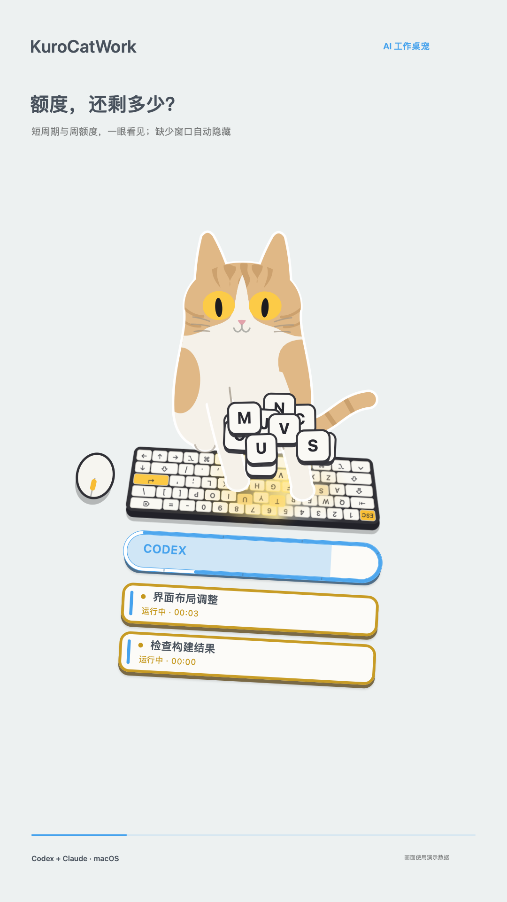
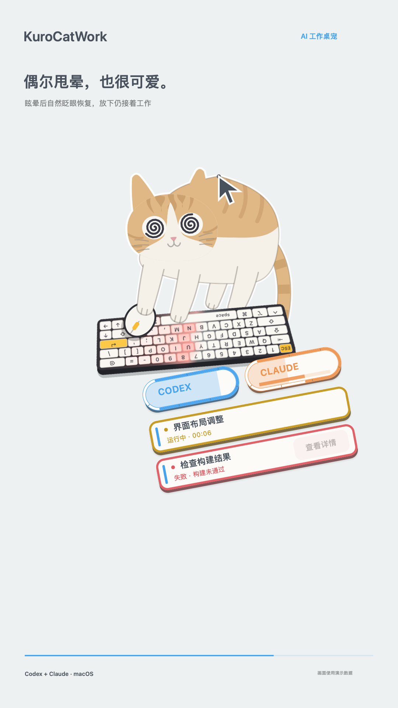
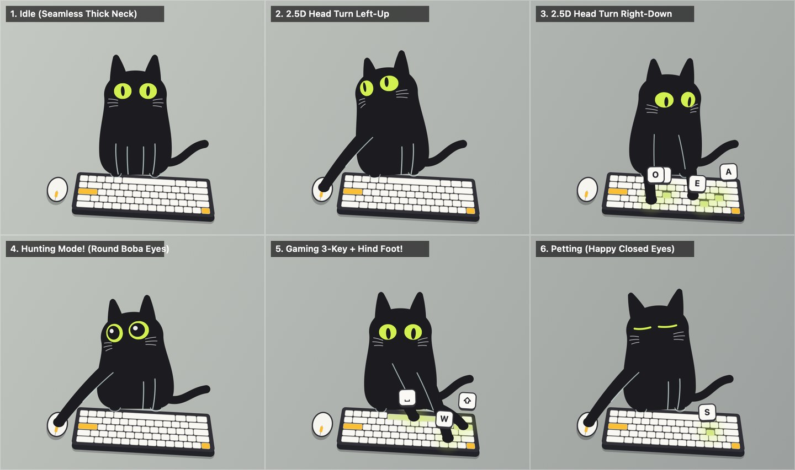
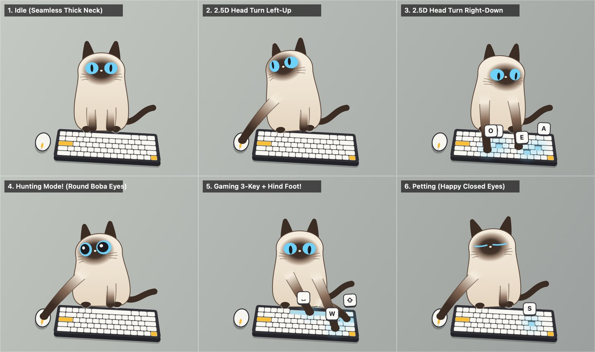
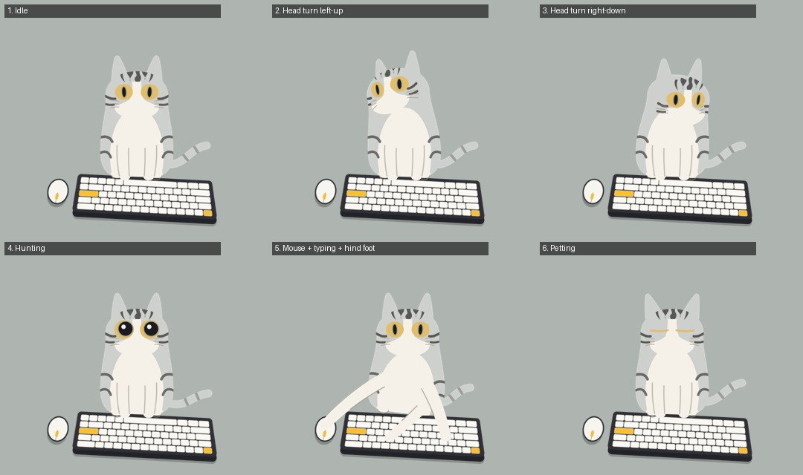
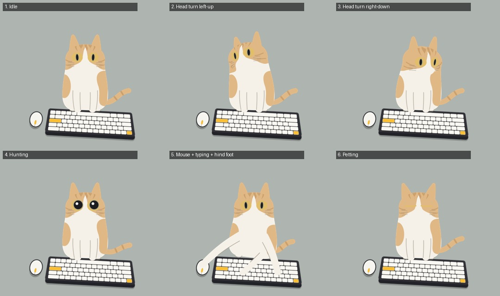
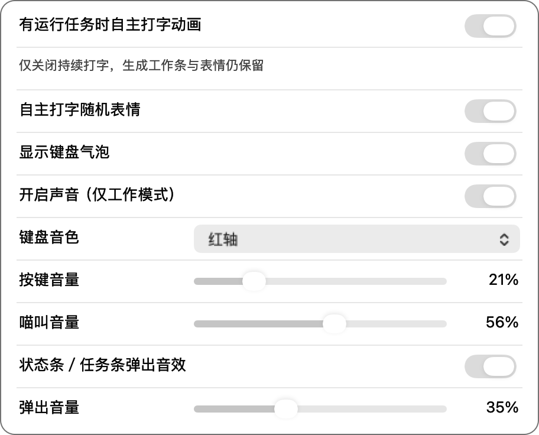

<h1 align="center">🐱 KuroCatWork</h1>

<p align="center">
  <b>陪你打字，也陪 AI 干活的原生桌面萌猫。</b><br/>
  普通陪伴与工作模式 · Codex / Claude · 任务泡泡 · 共通皮肤
</p>

<p align="center">
  <a href="https://github.com/andyforfun168/KuroCatWork/releases/latest"></a>
  
  <a href="LICENSE"></a>
</p>

<p align="center">
  <b>简体中文</b> | <a href="README.en.md">English</a> ·
  <a href="https://github.com/andyforfun168/KuroCatWork/releases/latest">⬇️ 下载</a> ·
  <a href="https://github.com/andyforfun168/KuroCatWork/releases/download/v1.4.4/KuroCatWork-demo.mp4">🎬 演示</a>
</p>

> 基于 [KuroCat](https://github.com/chanke17/KuroCat) 开发，为桌面小猫加入 Codex / Claude 工作模式。

<p align="center">
  <a href="https://github.com/andyforfun168/KuroCatWork/releases/download/v1.4.4/KuroCatWork-demo.mp4"></a>
  
</p>

<p align="center"><i>演示画面使用模拟额度与任务；实际使用需连接自己的工具和账户。</i></p>

---

## 💡 为什么选择 KuroCatWork？

让小猫继续当主角。双击就在普通桌宠和 AI 工作小搭档之间切换，额度、任务与提醒都围绕它的键盘展开；也能听着敲击声，感知任务有没有在忙。

| 对比维度 | 🐱 KuroCatWork | 常见 Electron / Web 桌宠实现 |
| :--- | :--- | :--- |
| **安装包体积** | macOS 通用版约 **2.1 MB**、Windows x64 约 **1.5 MB**、Linux 便携版约 **1.2 MB**，包含四款皮肤与声音素材 | 通常需要额外打包浏览器或其他运行时，体积取决于具体实现 |
| **内存 / CPU 占用** | **原生 Swift / C++17 绘制**；切回普通模式即停止 AI 额度与任务轮询 | 资源占用取决于页面、渲染进程和后台逻辑 |
| **游戏内按键捕获** | macOS **IOHIDManager**、Windows **Raw Input**、Linux **XInput2 / evdev**，按平台授权后驱动全局键鼠动作 | 网页内按键事件通常受焦点限制，全局输入需额外桥接 |
| **2.5D 视觉表现** | 鼠标跟随转头、捕猎大圆眼、圆润团睡，以及带惯性的**拎猫、键盘与鼠标 / 数位板** | 表现形式取决于项目，可采用贴图、骨骼或 3D 渲染 |
| **皮肤与生态** | 四款内置皮肤；兼容原作 [2.5D 皮肤工坊](https://workshop.kurocat.cc/) 的 **`.kurocat` / `.kurokb`** 格式，导入后可用于工作模式 | 素材格式由各项目定义，跨项目使用通常需要适配 |
| **隐私安全** | **开源，本地处理键鼠动画**；工作模式读取已连接工具的额度与任务状态，本地保存设置和任务元数据 | 数据处理方式与网络连接范围需查看各项目说明 |
| **普通陪伴 / AI 工作** | **双击小猫切换**；普通模式陪你打字，工作模式才亮起键盘流光并检查 AI 任务 | 是否具备任务监测与模式切换，取决于项目 |
| **Codex / Claude 额度** | 蓝色 / 橙色额度泡泡，显示剩余用量与重置时间；支持单工具、双工具及自动识别 | 通常需自行接入工具账户与额度来源 |
| **任务与处理提醒** | **运行黄、等待紫、完成绿、失败或终止红**；点击跳转对应聊天，等待时小猫抬头提醒 | 是否展示任务生命周期与聊天入口，取决于项目 |
| **声音与工作节奏** | **青轴 / 茶轴 / 红轴**、气泡弹出声与拎起喵叫；敲击声的开始和暂停帮助感知任务动静，音量独立可调 | 音色、任务联动与音量控制取决于项目 |
| **互动与彩蛋** | 自主双手打字、短暂停顿思考、随机小情绪、等待催促，以及**甩动约 1.2 秒的眩晕眼** | 互动规则与动画由各项目分别设计 |

<sub>体积以 v1.4.4 macOS 通用版为准。Windows x64、Linux x86_64 / ARM64 现提供原生工作模式安装包；兼容要求见下方平台说明。</sub>

---

## ✨ 特性亮点

- **⌨️ 双击，切换普通／工作模式**
  - 普通模式陪你打字、跟随鼠标、摸头、打瞌睡；工作模式才亮起 RGB 跑马灯，让工作状态一眼可辨。
  - 小猫按下空格，气泡先像普通按键一样升起，再变成键盘下方的立体长条；方向与键盘下缘平行，缩放时文字与泡泡一起等比例变化。
  - 可随时手动切回；没有运行或等待处理的任务满 **30 分钟**后自动回普通模式。工作模式不因闲置睡着，回普通模式后按原规则入睡。

- **🔵🟠 Codex ＋ Claude 额度，一眼看见**
  - 支持只显示 Codex、只显示 Claude、同时显示，或**自动识别**；单工具使用全宽额度条，识别到另一个工具后自动补上。
  - 主填充显示短周期剩余额度，细条显示本周剩余；外圈七段连续倒计时显示距离本周重置的时间，空段保留白色轮廓。
  - 悬停显示百分比、更新时间及准确倒计时。按账户实际可用的额度窗口显示；未提供的窗口显示为不可用。
  - 额度约每 **60 秒**刷新；断网或登录失效时保留上次数据，并标明状态。

- **🫧 任务变成小猫敲出来的泡泡**
  - 任务约每 **6 秒**检查。默认最多展示 **3 条**，其余可展开；等待处理优先，其次运行中，再是未查看的结果。
  - **运行黄／等待紫／完成绿／失败或终止红**。平时显示标题、状态与时长，悬停展开项目、来源和具体时间；信息卡会根据屏幕边缘调整位置。
  - 「打开处理」「查看结果」「查看详情」跳转到对应聊天；**审批仍由 Codex / Claude 完成，小猫不代替你批准操作**。终端任务没有可用聊天链接时，显示可用的来源信息。
  - 手动或自动退出工作模式时，已完成任务淡出清除；再次进入时，仍可查看尚未处理的等待项和失败任务。

- **🐾 会思考，也会闹小情绪**
  - 有运行任务且没有等待项时，小猫自主双手打字、看着键盘；你的真实键鼠操作优先，手部继续跟随你。
  - 每分钟偶尔放慢节奏约 **3 秒**，再平滑恢复。自主工作时约每分钟随机出现生气或转圈眼，长任务更容易眩晕，恢复时用连续双眨眼过渡。
  - 有等待处理的任务时暂停自主打字、看着你；等待超过 **5 分钟**会生气提醒，处理后逐渐平息。此时仍响应真实打字和鼠标移动。
  - **自主打字动画、随机表情、键盘气泡分别开关**。关闭打字气泡后，额度条与任务条仍通过空格气泡生成；关闭随机表情不影响等待提醒或甩动眩晕。

- **🔊 三种键盘音色与小喵叫**
  - 工作模式声音默认关闭；开启后可选 **青轴／茶轴／红轴**，使用各自真实录音裁切的短音色。
  - 额度条和任务条在气泡变成长条时发出不同的短促弹出声；批量生成时合并密集音效，避免叠得太吵。
  - 拎起小猫时轻轻「喵」一声。**按键、喵叫、弹出音效各有独立音量**，并可单独关闭弹出音效；退出工作模式或关闭总开关立即停声。

  - **用耳朵感知工作进度**：开启自主打字与声音后，离开键盘时也能通过敲击声的开始和暂停感知任务动静。任务完成或等待你处理时，自主敲击声会停下；再看绿色完成条或紫色等待条，就能确认发生了什么。真实打字也会发声，任务状态以泡泡条为准。

- **🤏 拎起来，工作也一起走**
  - 全身可拖拽，区分双击切模式与拖动；抓取点靠近背部，背、四肢、尾巴保留轻微惯性。
  - 右手带鼠标／数位板，左手带倾斜键盘；工作条在键鼠下方逐层弹簧跟随，移动中暂不响应条内按钮，避免误点。
  - 有效来回甩动累计约 **1.2 秒**触发眩晕眼，只改变表情、不在空中晕倒；放下仍继续原有恢复过程。

- **🎨 四款皮肤与原有桌宠彩蛋**
  - 黑猫、暹罗、美短、橘白；美短与橘白拥有纯白前爪、自然的肩部衔接、粉色鼻嘴，脸部细节随头部转动。
  - 重新选择橘白自动搭配「琥珀金瞳」，美短搭配「淡金青绿」，之后仍可自由换色。支持导入原作格式的 `.kurocat` 皮肤与 `.kurokb` 键盘。
  - **皮肤共通**：可在原作者的 [🎨 皮肤工坊／皮肤工厂](https://workshop.kurocat.cc/) 制作或下载皮肤，再到本软件换装间导入。沿用原作的皮肤格式，导入后既能陪你打字，也能在工作模式里敲键、转头、拖拽并显示工作条。
  - 2.5D 转头、捕猎大圆眼、摸头闭眼、尾巴躲闪、第三只脚和四键尾巴按键；四款小猫都有圆润的团睡造型，闭眼线随瞳色变化。

### 🎨 四款皮肤 6 态预览

| 经典小黑猫 | 暹罗猫 |
| :---: | :---: |
|  |  |

| 美短 | 橘白 |
| :---: | :---: |
|  |  |

---

## 📦 下载与开始使用

### 🍎 macOS 11+ · Apple Silicon / Intel 通用

1. 从 [Releases](https://github.com/andyforfun168/KuroCatWork/releases/latest) 下载 **`KuroCatWork-macOS-universal.zip`**，解压并将 `KuroCatWork.app` 放到「应用程序」。
2. 退出旧版小猫，再打开新版。首次使用按底部提示到 **系统设置 → 隐私与安全性 → 输入监控**授权，再从菜单重启小猫。
   - 当前安装包未作 Apple 公证；若 macOS 阻止首次打开，可在「隐私与安全性」中查看系统给出的打开选项。
3. **双击小猫**进入工作模式，首次选择 Codex、Claude 或两者；后续也可选自动识别。
4. 在右键菜单的 **工作模式 · 真实连接** 中连接工具：
   - **Codex**：本机需已有 Codex CLI；使用「登录 Codex…」或在终端运行 `codex login`。额度通过 `codex app-server` 读取，本地桌面／CLI 会话用于任务状态。
   - **Claude**：使用「连接 Claude 网页…」登录。Claude Code 本地会话可通过可选任务监听 hook 补充明确的等待审批／回答状态；安装前会提示并保留原有配置。
5. 到 **右键 → 设置 → 工作模式**，按喜好设置自主打字、随机表情、键盘气泡、声音、轴体和三类音量。大小与方向在右键滑条里调整。

### 🪟 Windows · x64

下载 **`KuroCatWork-Windows-x64.zip`**，完整解压后运行 `KuroCatWork.exe`。保留旁边的 `Resources` 文件夹，里面包含键盘声、气泡声和喵叫。双击小猫切换工作模式，右键 **工作模式**可选择工具、动画和声音。

以 **Windows 7 SP1 / 8 / 10 / 11 x64** 为兼容目标，使用 Windows 7 API 基线和静态 C++ 运行库。当前自动构建及窗口启动测试运行在 Windows Server 2022；旧系统兼容性尚需对应设备实测。AI CLI 的系统要求独立于桌宠，旧系统上不可用的工具会显示 N/A。

### 🐧 Linux · x86_64 / ARM64

- 便携版：下载对应架构的 **`KuroCatWork-Linux-x86_64.tar.gz`** 或 **`KuroCatWork-Linux-arm64.tar.gz`**，解压后运行 `./kurocatwork`。也可运行 `bash install.sh` 安装到当前用户目录，无需管理员密码。
- Debian / Ubuntu / 统信 UOS / 银河麒麟：提供 **`KuroCatWork-Linux-amd64.deb`** 和 **`KuroCatWork-Linux-arm64.deb`**，选择与系统架构一致的包。
- 需要 **glibc 2.28+、GTK3 3.22+、Cairo、X11 / XInput2**。适用于满足依赖的 UOS / 麒麟等发行版；Wayland 全局监听受系统限制，建议 X11 或支持对应输入能力的 XWayland 环境。
- 声音使用 PulseAudio / PipeWire 的 `paplay`；便携版若缺少声音，可通过发行版的软件管理器安装 `pulseaudio-utils`。

### Windows / Linux 真实连接

先安装并登录兼容当前系统的 **Codex CLI / Claude Code**。Codex 使用 `codex login`；Claude Code 使用其登录流程。额度与本地会话由小猫读取；等待审批 / 回答状态可在右键 **工作模式 → 连接任务监听**中启用对应 hook，原配置会保留并备份。

这两个平台使用本地 CLI 连接，不包含 macOS 的 Claude 网页登录窗口。终端会话没有可用深链接时显示项目与来源，供你返回原终端处理；小猫不会自动批准。详细构建与验证范围见 [跨平台说明](docs/CROSS_PLATFORM_PORT.md)。

### 使用前了解

- Codex / Claude 的本地数据结构和服务接口可能随版本变化；任务未出现时，先检查连接状态、对应工具是否登录，以及可选监听是否连接。
- 「打开处理」是跳转，不是自动批准。Claude 连接需要用户自行完成登录；登录后即可查看账户额度。
- macOS 版本沿用旧 KuroCat 的应用标识与设置路径以便迁移。**请退出另一只 KuroCat / KuroCatLocal 后使用**；同机不建议同时运行两者。设置尽量沿用，但更换签名后 macOS 可能要求重新授权输入监控。
- 当前下载包不是 Apple 公证版。若 macOS 阻止首次打开，可到「系统设置 → 隐私与安全性」按系统提示允许本次打开。
- 应用没有内置更新器，需要更新时手动下载本仓库 Release。

---

## ⚙️ 工作模式设置

<p align="center"></p>

开关与音量分别保存。普通模式不轮询 AI 额度或任务，也不播放工作模式音效；原有本地键鼠监听仍用于桌宠动画。

## 🔒 数据与隐私

键鼠输入用于本地动画，不上传按键内容。工作模式读取本机工具的额度与会话状态，并在连接 Claude 时访问其服务；本地保存位置、设置、额度缓存和任务元数据（例如标题、项目、状态、时间及是否已处理）。可选 hook 仅写入任务事件元数据，不代替工具执行命令或审批。没有额外的项目遥测服务器；请只在自己的可信电脑上连接账户。

## 🛠️ 从源码构建

Windows 使用 `windows/build.bat`（MSVC x64 开发者命令行）；Linux 使用 `bash linux/build.sh`，Debian 打包使用 `bash linux/build_deb.sh`。

macOS 需要 Xcode Command Line Tools（含 macOS SDK、Swift）及 macOS：

```bash
git clone https://github.com/andyforfun168/KuroCatWork.git
cd KuroCatWork
bash build.sh
open KuroCatWork.app
```

脚本生成 Apple Silicon + Intel 通用 App，声音与图标均随源码提供，无需额外下载依赖。未配置签名证书时使用 ad-hoc 签名。开发与验证说明见 [docs/DEVELOPMENT.md](docs/DEVELOPMENT.md)。

```text
KuroCatWork/
├── Sources/           # 桌宠、真实连接、工作模式、声音和设置
├── Resources/         # 图标、应用信息、CC0 音频素材
├── assets/            # 工作模式与皮肤预览
├── docs/              # 使用、开发与发布说明
├── tests/             # 隔离设置的本地检查
└── build.sh           # macOS 通用 App 构建
```

## 🤝 致谢与许可证

KuroCatWork 由 andyforfun168 独立维护，并非原作者的官方版本。原 fork 保留在 [KuroCatLocal](https://github.com/andyforfun168/KuroCatLocal)。喜欢纯桌宠与原作平台版本，可选择 KuroCat；希望小猫陪着 Codex / Claude 工作，可选择 KuroCatWork。

- [chanke17 / KuroCat](https://github.com/chanke17/KuroCat)：原生桌宠基础、角色、美术与互动生态。
- [andyforfun168](https://github.com/andyforfun168)：KuroCatWork 工作模式、相关交互与本仓库维护。
- 音频作者及许可见 [THIRD_PARTY_NOTICES.md](THIRD_PARTY_NOTICES.md)。

本项目采用 [MIT License](LICENSE)。
